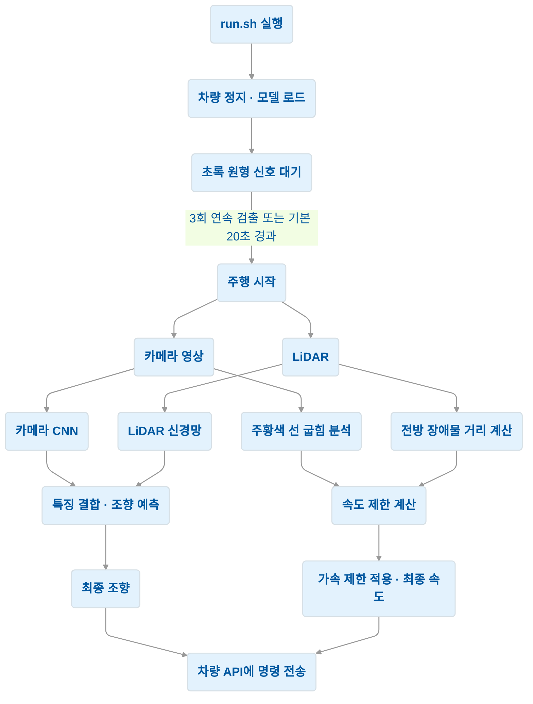

# 카메라·LiDAR 융합 자율주행 시스템

카메라 영상과 LiDAR 거리 정보를 함께 활용하는 자율주행 시스템입니다. **딥러닝 모델이 조향을 예측**하고, **규칙 기반 알고리즘이 커브와 전방 장애물에 따라 속도를 조절**합니다.

## 📁 파일 구성

| 파일 | 역할 |
|---|---|
| `run.sh` | 자율주행 프로그램을 실행하는 스크립트 |
| `drive_ver13_1.py` | 센서 수집, 출발 신호 인식, 모델 추론, 속도 결정 및 차량 제어를 담당하는 메인 프로그램 |
| `models_ver13/model.onnx` | 실제 주행에서 사용하는 추론용 딥러닝 모델 |
| `models_ver13/model.pt` | PyTorch 형식의 모델 가중치 |
| `models_ver13/model_best.pt` | 주행용 ONNX 모델과 동일한 가중치를 가진 PyTorch 모델 |

## 🚗 전체 동작 흐름

1. **초기화**  
   차량을 정지시키고 모델과 센서를 준비합니다.

2. **출발 신호 확인**  
   카메라에서 초록색 원형 신호를 확인합니다. 설정된 대기시간이 지나면 자동으로 출발할 수도 있습니다.

3. **조향 예측**  
   카메라 영상과 LiDAR 데이터를 딥러닝 모델에 입력하여 조향을 예측합니다.

4. **속도 결정**  
   주황색 주행선의 굽힘과 전방 장애물 거리를 분석하여 목표 속도를 결정합니다.

5. **차량 제어**  
   최종 속도와 조향 명령을 차량에 전달하며 주행을 반복합니다.

## 🧠 주요 알고리즘

### 1. 카메라·LiDAR 특징 융합

카메라 영상은 **합성곱 신경망(CNN)**으로 처리하고, LiDAR 거리 정보는 **완전연결 신경망(MLP)**으로 처리합니다. 두 센서에서 추출한 특징을 결합하여 조향을 예측합니다.

영상의 시각적 정보와 주변 물체의 거리 정보를 함께 활용하는 **멀티모달 센서 융합 방식**입니다.

> 모델은 속도와 전방 거리도 예측하지만, 현재 주행 코드에서는 조향 예측만 실제 제어에 사용합니다. 실제 속도는 별도의 규칙으로 결정합니다.

### 2. 색상·형상 기반 출발 신호 인식

카메라 영상에서 **HSV 색 공간**을 이용해 초록색 영역을 추출합니다. 잡음을 제거한 뒤 후보의 원형도와 형태를 검사하여 출발 신호를 판별합니다.

일시적인 오검출을 줄이기 위해 여러 프레임에서 연속으로 신호가 확인되면 출발합니다. 신호 인식은 출발 전에만 수행합니다.

### 3. LiDAR 기반 전방 장애물 검출

LiDAR 측정값을 차량 기준 좌표로 변환하고, 전방 주행 통로에 있는 점들을 추출합니다. 인접한 점들을 **군집화**하여 작은 장애물 후보를 찾고, 가장 가까운 후보의 거리를 계산합니다.

장애물의 종류를 분류하는 방식이 아니라, **점들의 위치와 크기를 이용하는 기하학적 검출 방식**입니다.

검출이 잠시 누락되어도 이전 정보를 유지하여 감속 판단이 급격하게 바뀌는 것을 줄입니다.

### 4. 주황색 주행선 기반 커브 판단

영상에서 주황색 주행선을 추출하고, 선의 위치에 **2차 다항식 곡선 맞춤**을 적용합니다. 곡선의 중간 지점이 양 끝점을 연결한 직선에서 얼마나 벗어나는지 계산하여 굽힘을 판단합니다.

굽힘에 따라 커브를 단계별로 분류하며, 연속 프레임의 판정과 **히스테리시스**를 이용해 상태가 빈번하게 바뀌는 것을 줄입니다.

### 5. 규칙 기반 속도 계획

커브의 심각도와 장애물까지의 거리를 바탕으로 각각 허용 속도를 계산합니다.

감속도와 제어 지연을 고려한 **거리 기반 감속 모델**을 사용하며, 계산된 제한 중 가장 낮은 값을 목표 속도로 선택합니다.

- **커브 감속:** 커브의 굽힘 정도와 추정된 남은 거리에 따라 속도를 낮춥니다.
- **장애물 감속:** 전방 장애물에 가까워질수록 속도를 낮춥니다.
- **센서 상태 반영:** LiDAR 데이터가 오래된 경우 속도를 제한합니다.
- **가속 제한:** 감속 명령은 즉시 반영하고, 가속은 점진적으로 적용합니다.

## ✨ 시스템 특징

- **딥러닝 조향과 규칙 기반 속도 제어를 결합한 구조**
- **카메라와 LiDAR의 특징을 결합하는 멀티모달 추론**
- **색상과 형상을 이용한 출발 신호 인식**
- **주행선 굽힘과 장애물 거리에 따른 상황별 감속**
- **별도 스레드에서 LiDAR를 수집하는 비동기 센서 처리**

## 📌 구현 범위 및 한계

- 장애물 회피 방향은 **신경망의 조향 예측**에 맡깁니다.
- 별도의 회피 경로 생성이나 장애물 접근에 따른 비상정지 알고리즘은 포함되어 있지 않습니다.
- 커브까지의 거리는 고정된 초기 거리와 속도 명령을 이용해 추정합니다.
- 제공된 파일은 주행 추론용 코드와 모델 가중치로 구성되어 있으며, 학습 데이터와 학습 과정은 포함되어 있지 않습니다.

## 🔄 시스템 구성도

